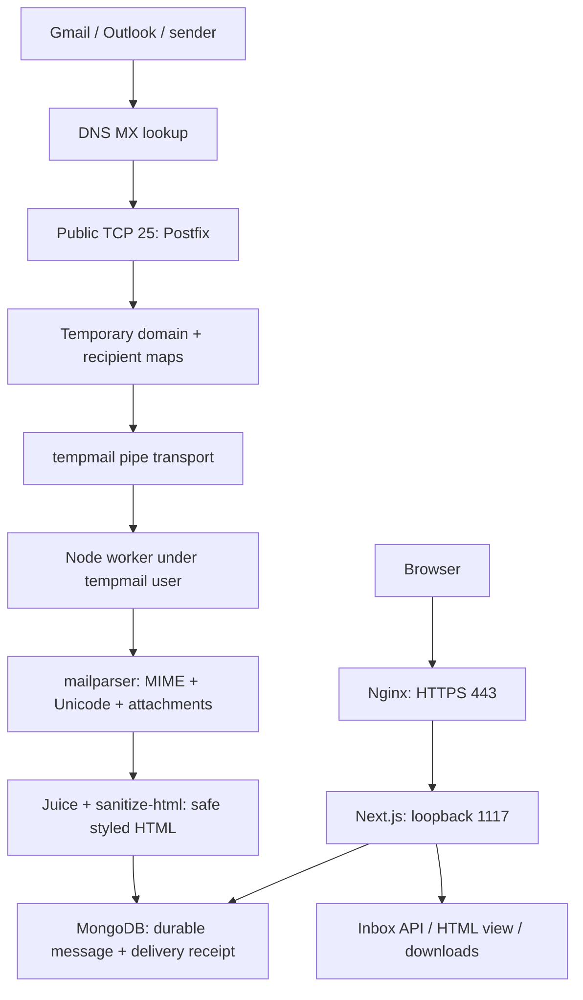

# TempMail: complete setup aur operation guide

> Current domain: **mailizator.com**. This walkthrough records the original setup. Follow [the Mailizator cutover guide](mailizator-migration.md) for current domain-specific settings.

Ye guide aapke project aur is conversation mein kiye gaye VPS setup ke liye hai. Ye fresh installation script nahi hai: already configured services ko dobara overwrite mat karo. Shell blocks terminal commands hain; `text`, `dotenv`, `nginx`, aur `javascript` blocks configuration/examples hain, terminal commands nahi.

## 1. Ab tak kya hua

1. Existing Next.js project mein public homepage, custom/random inbox generator, address copying aur `/inbox/[username]` UI banaya.
2. MongoDB models aur inbox/detail/attachment/health APIs banaye.
3. Independent stdin mail worker banaya, jo Postfix se RFC 5322/MIME message leta hai.
4. Direct fixture ingestion se worker → database → UI verify kiya.
5. VPS par `tempmail` Postfix transport missing tha; temporary domain ke maps aur dedicated pipe transport add kiya.
6. Node root ke NVM directory mein tha. Worker ke liye accessible Node copy aur restricted environment file prepare kiye.
7. Local Postfix queue se message successfully `relay=tempmail`, `status=sent` ke saath deliver hua.
8. External packets port 25 tak aa rahe the, lekin UFW default incoming deny tha aur 25/tcp missing tha. Targeted inbound allow rule diya; aapne subsequently real email receive hona confirm kiya.
9. Theme `#1B97C5`, matching dark mode, hover/entry/decorative animations aur reduced-motion support add kiya.
10. HTML formatting issue fix kiya: safe inline styles retain hote hain; embedded CSS locally inline karke filter hoti hai. Old stored emails ki stripped styling recover nahi hoti. Updated VPS worker deploy karne ke baad fresh email test chahiye.

Latest code validation: lint, typecheck, 19 tests, production build aur production HTTP smoke checks pass. Local automated checks external Gmail delivery prove nahi karte; external success aapke live test report se hai.

## 2. Addresses aur deployment paths

| Item                    | Value                                 | Role                                                                      |
| ----------------------- | ------------------------------------- | ------------------------------------------------------------------------- |
| Web URL                 | `https://email.fzeetechz.com`         | Browser mein app                                                          |
| Email domain            | `email.fzeetechz.com`                 | Address ka `@` ke baad wala part                                          |
| Example inbox           | `owner@email.fzeetechz.com`           | User-defined public inbox                                                 |
| Inbox URL               | `/inbox/owner`                        | Us address ke live messages                                               |
| Intended SMTP hostname  | `mail.email.fzeetechz.com`            | External mail server connection target                                    |
| VPS IPv4                | `194.238.19.154`                      | Server address                                                            |
| Project directory       | `/home/ubuntu/projects/tempmail`      | Actual deployed source/build                                              |
| Web app port            | `1117`                                | Nginx ke peeche Next.js                                                   |
| Worker OS account       | `tempmail`                            | Unprivileged ingestion process                                            |
| Worker Node binary      | `/opt/tempmail-node/bin/node`         | Accessible Node runtime copy                                              |
| Application environment | `/home/ubuntu/projects/tempmail/.env` | Next.js config                                                            |
| Worker environment      | `/etc/tempmail/worker.env`            | Explicit restricted worker config                                         |
| Expected PM2 name       | `fzeetechz-tempmail`                  | Repository configuration ka process name; live `pm2 list` se confirm karo |

`myhostname=fz.zeecodes.tech` existing Postfix setting preserve ki thi. Temporary domain receive karne ke liye VPS hostname ya existing outgoing mail identity replace nahi karna pada.

**Repository detail:** `ecosystem.config.cjs` ka example `cwd` abhi `/srv/tempmail` hai. Is file se process start/reconfigure karne se pehle `cwd` ko `/home/ubuntu/projects/tempmail` karo. Existing running process ka actual path `pm2 describe fzeetechz-tempmail` se inspect karo.

## 3. DNS mein kya records hone chahiye

Agar DNS zone `fzeetechz.com` hai:

| Type | DNS dashboard name | Value/target                              | Why                                                             |
| ---- | ------------------ | ----------------------------------------- | --------------------------------------------------------------- |
| A    | `email`            | `194.238.19.154`                          | Website hostname ko VPS tak resolve karna                       |
| A    | `mail.email`       | `194.238.19.154`                          | SMTP hostname ko VPS tak resolve karna                          |
| MX   | `email`            | `mail.email.fzeetechz.com`, priority `10` | `@email.fzeetechz.com` ke messages kis mail host ko bhejne hain |

Ye root domain `fzeetechz.com` ka MX replace karne ka instruction nahi hai. Sirf temporary-email subdomain ka record manage karo. MX target hostname hota hai, IP address, URL ya port nahi. DNS mein `:1117` nahi likhte.

Read-only lookup on 2026-11-12:

- `email.fzeetechz.com A = 194.238.19.154`
- `mail.email.fzeetechz.com A = 194.238.19.154`
- Actual `email.fzeetechz.com MX = 10 email.fzeetechz.com.`
- SMTP hostname ke liye is lookup mein AAAA answer nahi mila.

Actual MX intended target se alag hai. Dono hostnames same IP par resolve ho rahe hain, isliye current setup se mail receive ho sakti hai. Intended layout ke liye subdomain MX ko `mail.email.fzeetechz.com` par align kar sakte ho; change ke baad propagation aur delivery retest karo.

Cloudflare use karte ho to MX ka target A/AAAA **DNS only** hona chahiye. Standard Cloudflare HTTP proxy SMTP port 25 proxy nahi karta. Jab tak MX website hostname ko target kar raha hai, us hostname ko HTTP proxy ke peeche karna email delivery tod sakta hai. Separate DNS-only SMTP hostname par MX migrate karna is separation ko clear rakhta hai. [Cloudflare email documentation](https://developers.cloudflare.com/dns/troubleshooting/email-issues/)

Verification commands:

```bash
dig +short A email.fzeetechz.com
dig +short A mail.email.fzeetechz.com
dig +short MX email.fzeetechz.com
dig +short AAAA mail.email.fzeetechz.com
```

Sirf receiving functionality ke liye app ko outbound SMTP credentials, DKIM signing ya sender-domain SPF setup nahi chahiye. Existing domains ki SPF/DKIM/DMARC settings delete/change mat karo. Ye app sending/forwarding implement nahi karti; underlying Postfix apni normal delivery-status notifications generate kar sakta hai.

## 4. Full email flow



User ko mailbox pehle create/register nahi karna. `owner` ek logical recipient name hai, Linux user nahi. Postfix regex valid names accept karta hai; worker SMTP envelope recipient par message store karta hai. Email ke visible `To` header ko destination routing ka source nahi maante—Bcc aur multiple recipients ke liye envelope important hai.

Browser har five seconds mein, jab page visible ho, API poll karta hai. Mail worker frontend process se separate hai. Isi wajah se localhost par updated UI open karne se VPS ingestion code update nahi hota—even if dono same MongoDB use karte hain.

## 5. Project packages kisliye hain

| Package                                 | Role                                                                                                           |
| --------------------------------------- | -------------------------------------------------------------------------------------------------------------- |
| `next`                                  | App Router pages, server rendering, route-handler APIs, production build/server                                |
| `react`, `react-dom`                    | Interactive UI, client state, rendering/hydration                                                              |
| `mongoose`                              | MongoDB connection, message schemas, queries aur indexes                                                       |
| `mailparser`                            | Raw MIME se sender, subject, text, HTML aur attachment data extract karna                                      |
| `sanitize-html`                         | HTML tags/attributes/CSS allowlist; scripts aur unsafe content remove karna                                    |
| `juice`                                 | Email ke embedded CSS rules ko inline styling mein convert karna; synchronous API, no remote resource fetching |
| `dotenv`                                | Worker aur scripts mein explicit environment file load karna                                                   |
| `zod`                                   | Environment values aur allowed ranges validate karna                                                           |
| `tsx`                                   | Worker aur scripts ke TypeScript imports Node se run karna; production dependency rehni chahiye                |
| `lucide-react`                          | Mail, copy, refresh, attachment, theme aur other UI icons                                                      |
| `tailwindcss`, `@tailwindcss/turbopack` | CSS styling/build integration                                                                                  |
| `typescript`                            | Static type checking                                                                                           |
| `eslint`, `eslint-config-next`          | Code quality aur Next/React lint rules                                                                         |
| `@types/*`                              | Dependencies aur runtime APIs ki TypeScript declarations                                                       |
| `mongodb-memory-server`                 | Tests ke liye real isolated temporary MongoDB process; first run binary download hota hai                      |

Bun package manager/script runner hai. Node actual production worker/web runtime hai. Nginx, PM2, Postfix aur MongoDB OS/server services hain; ye frontend npm packages nahi hain. Production dependency installation se `mongoose`, `mailparser`, `juice`, `sanitize-html`, `dotenv` aur `tsx` remove mat karna.

## 6. Environment settings

Neeche example hai—existing real `.env` ko is example se overwrite mat karo. Actual database authenticated/private URI ho sakti hai.

```dotenv
MONGODB_URI=mongodb://127.0.0.1:27017/tempmail
MAIL_DOMAIN=email.fzeetechz.com
NEXT_PUBLIC_MAIL_DOMAIN=email.fzeetechz.com
MAIL_RETENTION_HOURS=1
MAX_EMAIL_SIZE_MB=2
MAX_STORED_BYTES=268435456
TRUST_PROXY=true
```

- `MONGODB_URI`: messages kis database mein store honge. Browser ko kabhi expose nahi karna.
- `MAIL_DOMAIN`: worker/API ke accepted envelope domain.
- `NEXT_PUBLIC_MAIL_DOMAIN`: browser par displayed address domain. Dono domain values identical rakho. Public value build-time par bundle hoti hai, isliye domain change par rebuild chahiye.
- `MAIL_RETENTION_HOURS`: naye message ki lifetime; default one hour. Existing message ki saved expiry automatically reset nahi hoti.
- `MAX_EMAIL_SIZE_MB`: raw message limit; default 2 MiB.
- `MAX_STORED_BYTES`: estimated message/attachment content admission quota; default 256 MiB. Ye total physical MongoDB disk ceiling nahi hai.
- `TRUST_PROXY=true`: sirf tab jab Next.js exclusively trusted loopback Nginx proxy ke peeche ho aur Nginx `X-Real-IP` overwrite karta ho. Direct development ke liye false.
- `MAIL_ENV_FILE`: worker ko externally batata hai kis file se server configuration load karni hai. Postfix transport mein `/etc/tempmail/worker.env` set hai.

Next.js `.env` load karta hai, lekin worker default `.env.local` dekhta hai unless `MAIL_ENV_FILE` supplied ho. Isi mismatch ko explicit worker env path se fix kiya.

Application `.env` update karne ke baad worker snapshot refresh karna ho to:

```bash
sudo install -o root -g tempmail -m 0640 \
  /home/ubuntu/projects/tempmail/.env \
  /etc/tempmail/worker.env
```

Secrets logs/chat/Git mein paste mat karo. `NEXT_PUBLIC_` sirf intentionally public values ke liye hai.

## 7. MongoDB mein kya store hota hai aur kyun

`emails` mein envelope recipient/sender, message ID, unique delivery hash, sender/header addresses, subject, text, sanitized HTML, received/expiry dates aur attachment metadata/binary data store hote hain.

Attachments protected MongoDB subdocuments mein hain, `public/` folder mein nahi. Metadata API mein aata hai; bytes sirf allowed attachment download route se milte hain. Message delete hone par uske embedded attachment bytes bhi delete hote hain.

Indexes:

- Recipient aur received time: inbox queries ke liye.
- Unique `deliveryId`: same delivery ki duplicate message insertion prevent karne ke liye.
- `expiresAt` TTL: automatic message cleanup.
- Delivery receipt TTL: seven-day retry history cleanup.
- Rate bucket TTL: old API rate counters cleanup.

TTL deletion instant guarantee nahi hoti; APIs independently expiry filter karti hain. Expired message detail/download bhi unavailable hota hai. Seven-day receipts retry se expired messages revive hone se bachati hain. Pending receipt original lifetime freeze karti hai if a worker crashes mid-delivery.

Runtime database user dedicated application database tak restricted hona chahiye. Same VPS MongoDB ho to loopback/private authenticated access prefer karo. Aapke earlier UFW output mein `27017 ALLOW Anywhere` tha: check karo kya doosri applications remotely depend karti hain, phir operator-led restriction plan karo; shared rule blindly delete mat karo.

Initialize/check project indexes using configured worker environment:

```bash
cd /home/ubuntu/projects/tempmail
MAIL_ENV_FILE=/etc/tempmail/worker.env bun run db:indexes
```

## 8. Postfix configuration aur uski wajah

Existing Postfix ko reinstall nahi kiya; dedicated temporary-domain receiving add ki. Existing hostname, trusted networks, relay restrictions aur doosri app ki sending preserve ki. Domain classification aur pipe setup Postfix ke [virtual-domain](https://www.postfix.org/VIRTUAL_README.html) aur [pipe](https://www.postfix.org/pipe.8.html) mechanisms use karte hain.

Configured main.cf entries:

```text
virtual_mailbox_domains = email.fzeetechz.com
virtual_mailbox_maps = regexp:/etc/postfix/tempmail_recipients
transport_maps = hash:/etc/postfix/tempmail_transport
tempmail_destination_recipient_limit = 1
tempmail_destination_concurrency_limit = 2
tempmail_time_limit = 60s
```

`virtual_mailbox_domains`: domain receive karna allowed hai. `virtual_mailbox_maps`: valid names exist logically; no account registration. `transport_maps`: this domain ko dedicated worker tak route karna. Recipient limit 1: every envelope recipient independently deliver hota hai. Process limit 2: shared VPS par bounded worker concurrency. Time limit: stuck deliveries queued retry hon, indefinitely hang nahi.

Recipient map file `/etc/postfix/tempmail_recipients`:

```text
/^[a-z0-9]([a-z0-9._+-]{0,62}[a-z0-9])?@email[.]fzeetechz[.]com$/ OK
```

Transport map file `/etc/postfix/tempmail_transport`:

```text
email.fzeetechz.com tempmail:
```

Transport hash map change ke baad `postmap /etc/postfix/tempmail_transport` chahiye. Regexp recipient map ko hash compile nahi karna.

Dedicated master.cf service equivalent:

```text
tempmail unix - n n - 2 pipe
  flags=X user=tempmail directory=/home/ubuntu/projects/tempmail
  argv=/usr/bin/env MAIL_ENV_FILE=/etc/tempmail/worker.env /opt/tempmail-node/bin/node --import tsx /home/ubuntu/projects/tempmail/workers/receive-mail.js --sender=${sender} --recipient=${recipient}
```

Worker root ke under nahi chalta. Project read access chahiye, source write access nahi. Root NVM path ko accessible banane ke liye `/root` permissions widen nahi ki; dedicated Node binary copy use ki. Is copied runtime ko Node security upgrades ke waqt separately update/test karna hoga.

Worker exits:

| Code | Meaning                                                                 |
| ---- | ----------------------------------------------------------------------- |
| 0    | Processing durable storage ke baad successful                           |
| 75   | Temporary database/quota/contention/timeout failure; Postfix retry kare |
| 65   | Invalid/oversized message ya resource limit violation                   |
| 67   | Unsupported/invalid recipient                                           |
| 64   | Invalid worker invocation arguments                                     |

Relay restrictions mein `defer_unauth_destination` preserve kiya gaya. Arbitrary external domains ke liye relaying permit mat karo. New domains/maps add karte waqt existing lists replace nahi karni—upar current setup isliye fit hua kyunki aapke relevant maps empty the.

Read-only verification:

```bash
sudo postconf -M tempmail/unix
sudo postconf virtual_mailbox_domains virtual_mailbox_maps transport_maps
sudo postconf smtpd_relay_restrictions
sudo postfix check
sudo postqueue -p
```

Postfix config badalne ke baad successful validation par manual reload chahiye. Sirf worker JS/TS code update par Postfix reload nahi chahiye: next pipe invocation source fresh load karti hai.

## 9. Nginx, HTTPS aur PM2

Browser traffic: DNS A → VPS HTTPS 443 → Nginx vhost → `127.0.0.1:1117` → Next.js.

DNS port select nahi karta. Nginx mein domain matching hoti hai:

```nginx
server_name email.fzeetechz.com;
```

Proxy target:

```nginx
proxy_pass http://127.0.0.1:1117;
proxy_set_header Host $host;
proxy_set_header X-Real-IP $remote_addr;
proxy_set_header X-Forwarded-For $remote_addr;
proxy_set_header X-Forwarded-Proto $scheme;
```

Ye snippets existing `server`/`location` blocks mein belong karte hain, standalone complete nginx.conf nahi. Full repository example `docs/nginx.conf` hai. Existing live vhosts preserve karo. API responses cache mat karo; actual expiry/read state stale ho sakti hai. HTTPS certificate website hostname cover kare. HTTP 80 se HTTPS redirect configured hona chahiye. SMTP STARTTLS separate Postfix configuration hai; Nginx web certificate automatically SMTP configure nahi karta. Existing SMTP TLS policy review kiye bina replace mat karo.

PM2 ka job Next.js web process ko run/restart karna hai. Worker stdin-driven on-demand Postfix child hai; usko permanent PM2 listener mat banao.

`ecosystem.config.cjs` mein actual path se `cwd` align karo; ye JavaScript file entry hai, shell command nahi:

```javascript
cwd: "/home/ubuntu/projects/tempmail",
args: "start --hostname 127.0.0.1 --port 1117",
```

Inspect current process before changing it:

```bash
pm2 list
pm2 describe fzeetechz-tempmail
```

Configured startup process absent ho tab, correct PM2 user ke under:

```bash
cd /home/ubuntu/projects/tempmail
pm2 start ecosystem.config.cjs --only fzeetechz-tempmail
pm2 save
```

Existing process ho to duplicate start mat karo. Live PM2 process name/file path confirm karke targeted restart use karo. Boot persistence existing PM2 user ke saath configure/verify karo; doosre users/apps ka PM2 daemon reset mat karo. [PM2 startup documentation](https://pm2.keymetrics.io/docs/usage/startup/)

## 10. Required ports aur firewall

| Port        | Public access                         | Why                                               |
| ----------- | ------------------------------------- | ------------------------------------------------- |
| TCP 25      | Required inbound                      | Gmail/Outlook se server-to-server SMTP            |
| TCP 443     | Required inbound                      | Website HTTPS                                     |
| TCP 80      | Web redirect/ACME setup ke mutabiq    | HTTP → HTTPS aur certificate workflow             |
| TCP 22      | Operator-managed access               | SSH; existing access preserve karo                |
| TCP 1117    | Public open karna required nahi       | Next.js loopback Nginx upstream                   |
| TCP 27017   | Private/authenticated database access | Browser ya public SMTP clients ke liye nahi       |
| TCP 465/587 | Is app ke liye required nahi          | App client email submission implement nahi karti  |
| TCP 993/995 | Is app ke liye required nahi          | App IMAP/POP mailbox service implement nahi karti |

Aapke earlier packet capture mein incoming SYN packets port 25 tak aa rahe the, lekin UFW allow rule missing tha. Targeted rule diya tha:

```bash
sudo ufw allow 25/tcp comment 'Postfix inbound SMTP'
```

Ye already apply ho chuka ho to dobara firewall rebuild/reset mat karo. Rules inspect karo:

```bash
sudo ufw status verbose
sudo ss -lntp '( sport = :25 )'
sudo ss -lntp '( sport = :1117 )'
```

Provider firewall/security group bhi inbound TCP 25 allow kare. Port 5025 allow hone se standard SMTP port 25 allow nahi hota. Existing unrelated firewall rules ko is setup ke naam par modify mat karo.

## 11. HTML rendering ka fix

Pehle sanitizer safe tags retain karta tha lekin sab `style` attributes discard kar deta tha. Isliye sender ki email mein blue heading/big spaced OTP tha, receiver mein plain text-like formatting thi.

Ab pipeline:

1. mailparser HTML extract karta hai.
2. Juice bounded embedded stylesheet rules ko inline karta hai, remote resources fetch kiye bina.
3. sanitize-html sirf allowed CSS properties aur values retain karta hai.
4. Stored sanitized HTML API se milti hai.
5. Viewer HTML available hone par HTML mode open karta hai; plain text selectable hai.
6. Sandboxed iframe + separate CSP scripts, remote images/fonts/styles aur network calls block karte hain.

Colors, font size/weight/family, letter spacing, margins, padding, borders aur table layout supported hain. Full Gmail pixel-perfect compatibility promise nahi hai: remote images, unsupported CSS, media-query behavior, overlays, scripts aur active content intentionally retain nahi hote. Large stylesheets fall back to safe inline-only sanitization.

**Fresh message VPS par updated worker se process honi chahiye.** Frontend-only deployment ya old message refresh se already removed CSS wapas nahi aayegi.

## 12. Normal deployment ka sequence

Pehle updated source, `package.json`, `bun.lock`, `lib/`, worker aur frontend files VPS release mein transfer/pull karo. Local workstation changes VPS par automatically nahi pahunchti.

Project directory mein:

```bash
cd /home/ubuntu/projects/tempmail
bun install --frozen-lockfile
bun run lint
bun run typecheck
bun run build
```

Har command successful hone ke baad next chalao. Then correctly configured/named existing process restart:

```bash
pm2 restart fzeetechz-tempmail
```

PM2-injected environment change hua ho to `--update-env` relevant hai. `.env` server changes ke liye process restart, aur `NEXT_PUBLIC_` changes ke liye rebuild bhi chahiye. [PM2 environment documentation](https://pm2.keymetrics.io/docs/usage/environment/)

`.env` change hui ho to worker env snapshot ko section 6 ke command se refresh karo. Updated source next Postfix delivery mein load hota hai. Node dependency updates deploy karna zaroori hai; sirf `.next` output copy karne se unbundled worker dependencies update nahi hoti.

Verify:

```bash
curl -i http://127.0.0.1:1117/api/health
curl -i https://email.fzeetechz.com/api/health
```

Domain change par DNS, Nginx hostname/certificate, both environment domains, Postfix domain/maps aur rebuild sab align karne honge. App update ko hostname/global firewall change ke saath automatically combine mat karo.

## 13. Full testing ka correct order

A. Automated isolated checks (prefer local/CI if VPS memory tight):

```bash
bun run test
bun run build
bun run test:http
```

B. Worker under actual service user:

```bash
sudo -u tempmail /bin/sh -c '
cd /home/ubuntu/projects/tempmail &&
MAIL_ENV_FILE=/etc/tempmail/worker.env \
/opt/tempmail-node/bin/node --import tsx workers/receive-mail.js \
--sender=sender@example.org \
--recipient=worker-permission-test@email.fzeetechz.com \
< tests/fixtures/sample.eml
'
```

Exit 0 successful. Repeated identical fixture idempotent hai; one-hour expiry ke baad same bytes retry karne par seven-day receipt usko revive nahi karegi. New test ke liye new recipient ya fixture Message-ID use karo.

C. Local Postfix queue → worker test:

```bash
/usr/sbin/sendmail -i -f sender@example.org \
  postfix-test@email.fzeetechz.com \
  < /home/ubuntu/projects/tempmail/tests/fixtures/sample.eml
sudo tail -n 40 /var/log/mail.log
sudo postqueue -p
```

`relay=tempmail`, `status=sent` means local pipeline success. Ye public port 25 prove nahi karta.

D. Gmail/Outlook external test:

- Fresh email to `postfix-test@email.fzeetechz.com` with unique subject.
- VPS par `sudo tail -f /var/log/mail.log`.
- Browser mein `/inbox/postfix-test`; polling should reveal message.
- HTML formatting, allowed attachment download, multiple-recipient delivery aur eventual expiry verify karo.
- Untrusted external host se relay-denial test karo; localhost trusted network se test karke open relay ka conclusion mat nikalo.

E. Styling-specific fixture:

`tests/fixtures/styled-email.eml` mein safe colored heading, spaced code, centered card aur table layout hai. Actual worker se new recipient ke liye ingest karke HTML mode inspect kar sakte ho. It contains an example code, not a real credential.

## 14. Failure kis layer par hai

| Evidence                                            | Likely next investigation                                      |
| --------------------------------------------------- | -------------------------------------------------------------- |
| Website unavailable                                 | DNS A, TLS, Nginx, PM2                                         |
| Health API 503                                      | MongoDB connectivity/configuration/service resource failure    |
| Direct worker succeeds, Postfix fails               | Pipe service, file paths, permissions, worker env              |
| Local Postfix succeeds, external connection absent  | MX, provider firewall, UFW, public TCP 25                      |
| Incoming SYN reaches eth0, no SMTP connection       | Host firewall/return path/handshake diagnostics                |
| SMTP `relay access denied` for your own temp domain | Domain classification/maps                                     |
| SMTP `user unknown`                                 | Recipient lookup/validation                                    |
| Worker temporary failure / `status=deferred`        | DB, quota, lease contention, runtime or permission issue       |
| Mail arrives but style missing                      | VPS worker release/dependencies, sanitized-at-ingestion timing |
| Copy/read state issue only                          | Browser/local storage/clipboard permissions                    |

Useful read-only commands:

```bash
pm2 logs fzeetechz-tempmail --lines 80
sudo tail -n 80 /var/log/mail.log
sudo tail -n 80 /var/log/nginx/tempmail-error.log
sudo postqueue -p
sudo postconf -M tempmail/unix
sudo nginx -t
sudo postfix check
df -h
free -m
```

Logs containing raw email/credentials ko public share mat karo. A repeated log line ko shell command ki tarah run mat karo; terminal commands aur logged results alag cheezein hain.

## 15. Retention, limits aur maintenance

Default: message expiry one hour, raw message 2 MiB, estimated content quota 256 MiB, attachment whitelist, maximum 20 MIME attachments, two Postfix workers, shared API limit 120 requests/minute/client. Nginx example additional rate limiting deta hai; live config mein apply hua hai ya nahi inspect karo.

Actual MongoDB disk use in limits se higher ho sakta hai due indexes, journal, receipt/rate data aur allocation. Postfix queue, PM2/Nginx logs, builds aur test binaries bhi disk consume karte hain. Your 14 GB free/no-swap VPS par bounded logs, TTL progress, free space aur memory monitor karo. Full disk par queued mail ko manually delete/flush mat karo; cause fix karo aur normal retries preserve karo.

Backup/rollback ke liye:

- Previous source/build release retain karo.
- Postfix backup directory jo setup se pehle banayi thi retain karo.
- App rollback mein sirf named PM2 process update/restart karo.
- Postfix rollback mein reviewed config restore, `postfix check`, then reload.
- Nginx rollback mein dedicated vhost restore, `nginx -t`, then reload.
- `pm2 restart all`, `ufw reset`, hostname replacement, shared queue deletion ya database deletion ki zaroorat nahi.

Public inboxes private nahi hain. Anyone knowing/guessing a name can read messages and allowed attachments. Downloads antivirus-scanned nahi hain. This remains a receive-only public temporary email platform.
